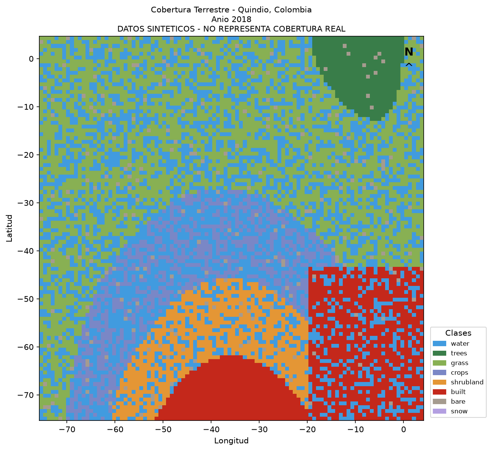
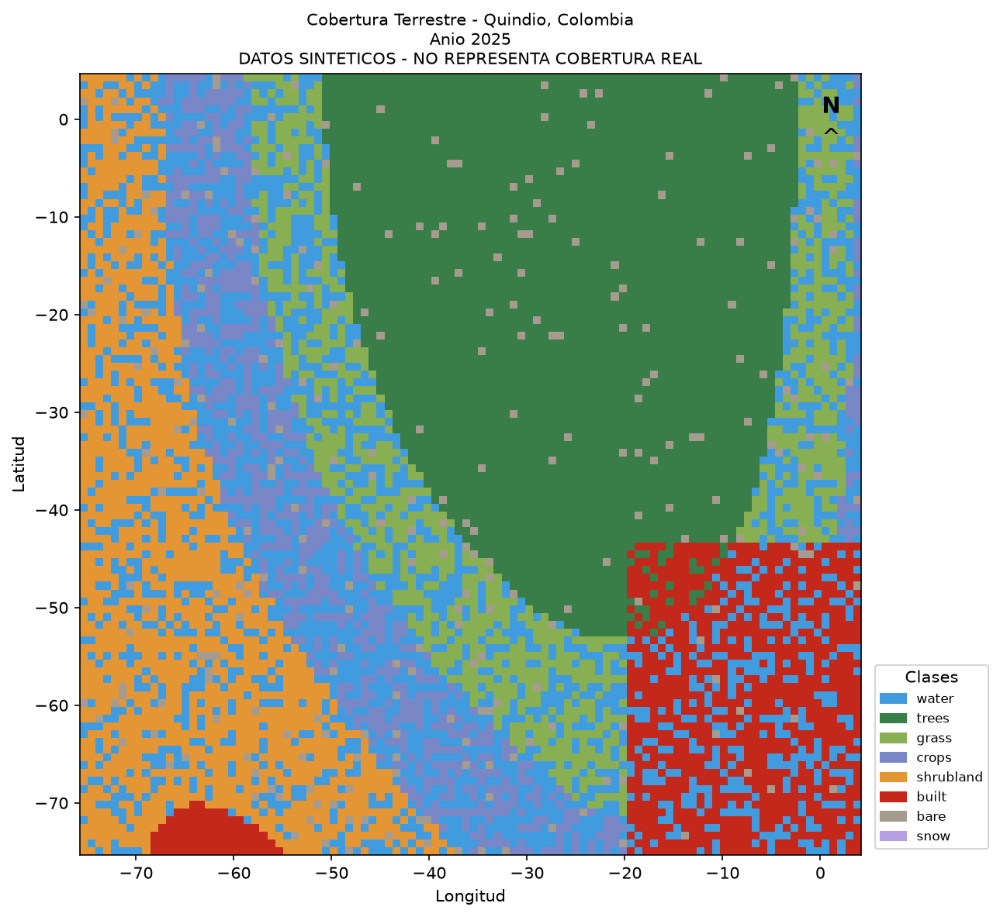
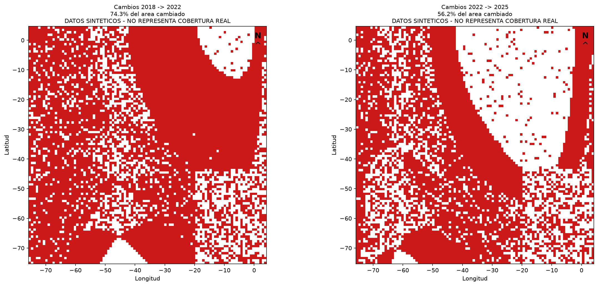
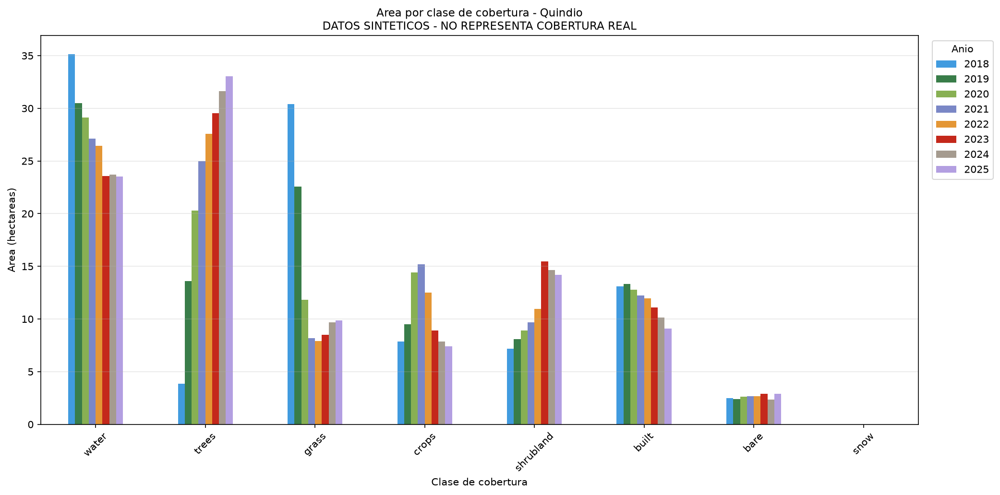
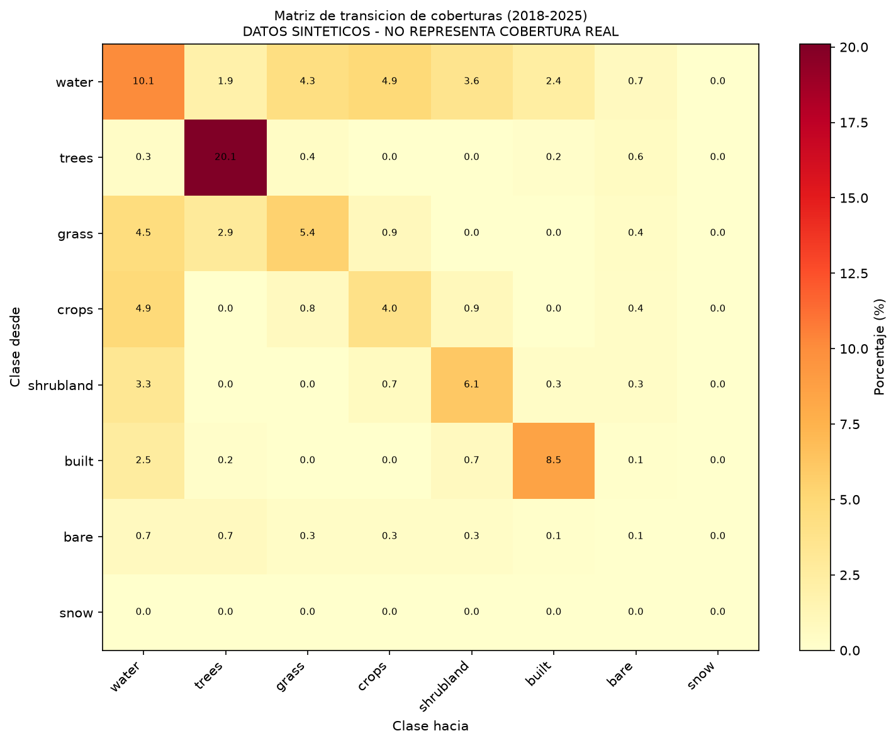
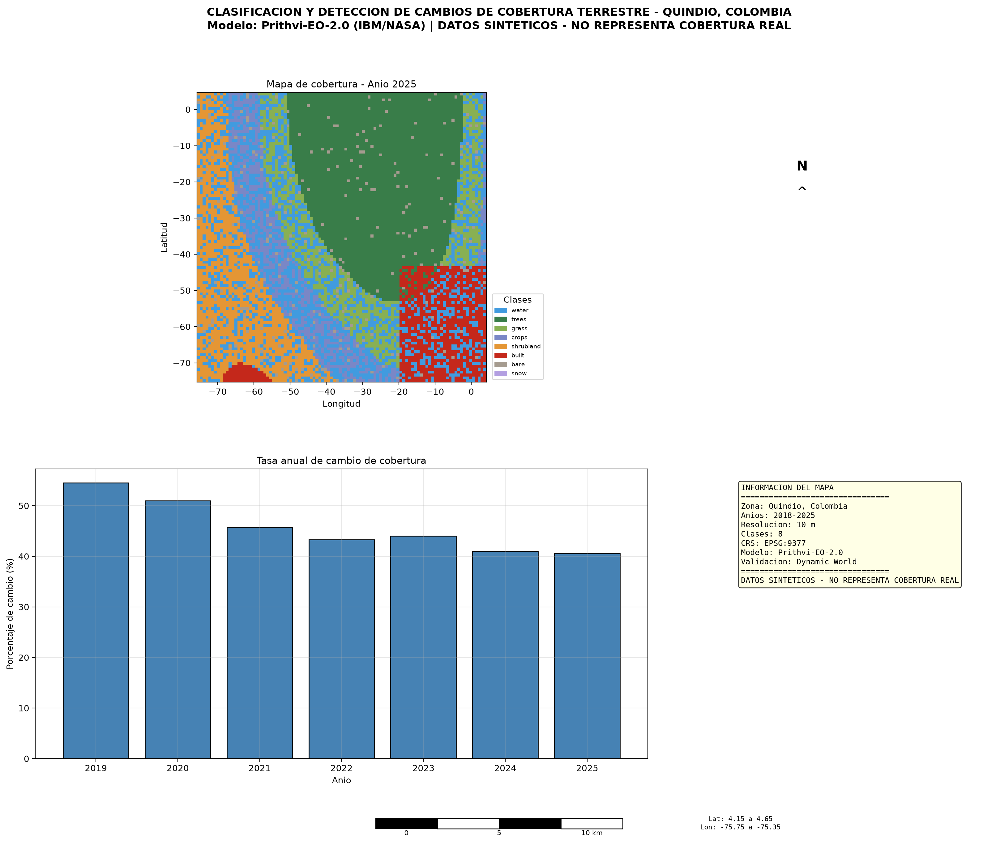

# Clasificación y Detección de Cambios de Cobertura Terrestre — Quindío, Colombia

Programa de clasificación de cobertura terrestre y detección de cambios temporales para el departamento del Quindío, Colombia, usando modelos de inteligencia artificial espacial de código abierto.

## Modelos de IA Espacial

| Modelo | Tipo | Uso |
|--------|------|-----|
| Prithvi-EO-2.0 (IBM/NASA) | Foundation Model geoespacial | Clasificación principal de cobertura |
| Dynamic World (Google) | Clasificación LULC | Validación de referencia |
| SAM 2 (Meta) | Segmentación universal | Delimitación de zonas de cambio |

## Estructura del Proyecto

```
src/
├── 00_config.py                    # Configuración centralizada
├── 01_descarga_datos.py            # Descarga Sentinel-2 y Dynamic World
├── 02_preprocesamiento.py          # Cloud masking y composición anual
├── 03_clasificacion_prithvi.py     # Clasificación con Prithvi-EO-2.0
├── 04_deteccion_cambios.py         # Detección de cambios temporales
├── 05_metricas_validacion.py       # Validación contra Dynamic World
├── 06_visualizacion.py             # Mapas y figuras
├── 07_exportar_resultados.py       # Exportación final
└── 08_generar_ejemplo_sintetico.py # Visualizaciones de ejemplo (datos sintéticos)
```

## Visualizaciones de Ejemplo (DATOS SINTÉTICOS)

> **ADVERTENCIA:** Las siguientes imágenes fueron generadas con datos sintéticos para demostrar el pipeline visual. NO representan la cobertura real del Quindío.

### 1. Mapa de Cobertura por Año




### 2. Mapa de Cambios entre Fechas



### 3. Área por Clase en Cada Año



### 4. Matriz de Transición (Mapa de Calor)



### 5. Layout Final Cartográfico



## Configuración

1. Crear archivo `config.yaml` en la raíz del proyecto (o usar variable de entorno `EE_PROJECT`)
2. Instalar dependencias: `pip install -r requirements.txt`
3. Autenticar Earth Engine: `earthengine authenticate`

## Uso

```bash
python -m src.01_descarga_datos
python -m src.02_preprocesamiento
python -m src.03_clasificacion_prithvi
python -m src.04_deteccion_cambios
python -m src.05_metricas_validacion
python -m src.06_visualizacion
python -m src.07_exportar_resultados
```

## Notas

- CRS de cálculo: EPSG:9377 (MAGNA-SIRGAS Origen-Nacional)
- CRS de salida: EPSG:4326
- Resolución: 10m (Sentinel-2)
- Años de análisis: 2018-2025
- Zona de estudio: 12 municipios del Quindío

## Estudiante

Maicol J. Torres — based-minion-3651
Universidad Distrital Francisco José de Caldas
